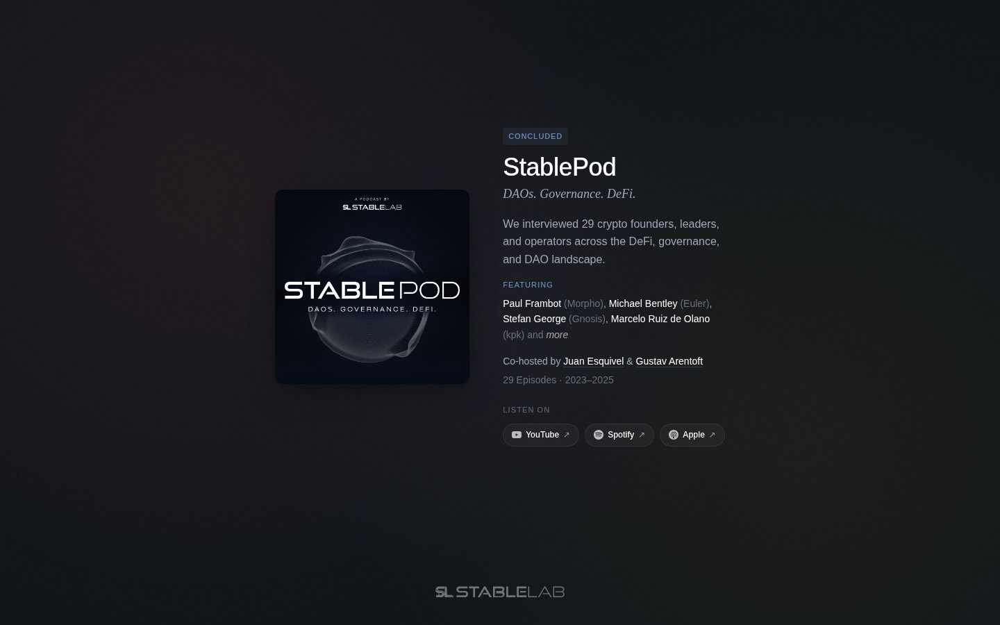

# StablePod



StablePod was StableLab's podcast on DAO governance and DeFi. It ran for 29 episodes from 2023 to 2025. I co-hosted the show with Gustav Arentoft and built this archive page for it.

The page introduces the show and its featured guests, and it links to every platform that streams the episodes.

## Stack

Astro 5 with TypeScript. The page loads Crimson Pro and Space Grotesk from Google Fonts.

## Run it locally

```bash
npm install
npm run dev
```

The dev server runs at [localhost:4321](http://localhost:4321). `npm run build` checks types with `astro check` and then builds the page.
